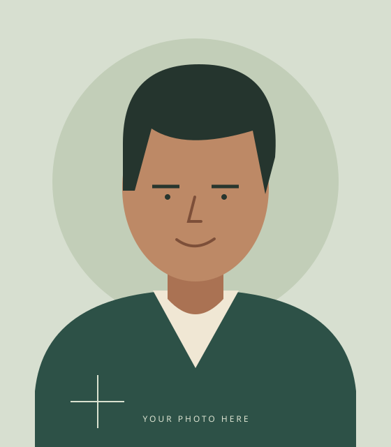
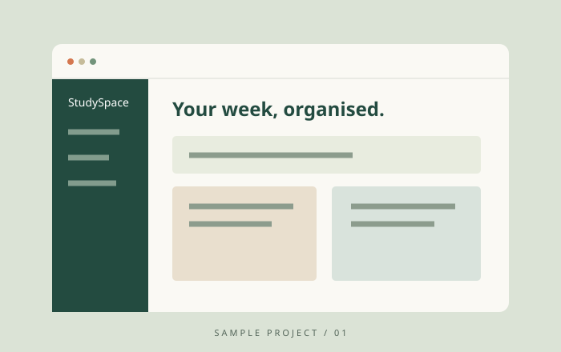
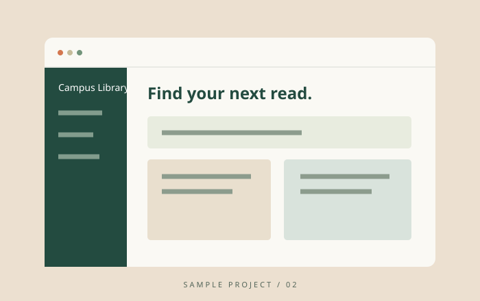
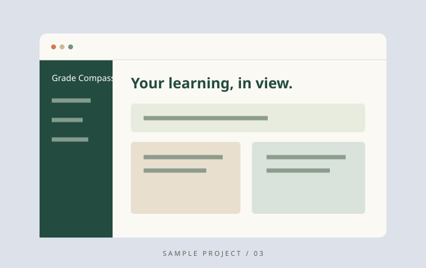

# Complete website source

Save the files using the paths below. The binary audio is included in the downloadable ZIP under assets/introduction.wav.

```text
student-portfolio/
  index.html
  about.html
  projects.html
  planner.html
  contact.html
  index.css
  script.js
  README.md
  assets/
    portrait.svg
    project-01.svg
    project-02.svg
    project-03.svg
    introduction.wav
```

## index.html

```html
<!DOCTYPE html>
<html lang="en">
<head>
    <meta charset="UTF-8">
    <meta name="viewport" content="width=device-width, initial-scale=1">
    <meta name="description" content="Alex Morgan’s sample student portfolio, projects and academic planner.">
    <title>Home | Chukwunonso</title>
    <link rel="stylesheet" href="index.css">
    <script src="script.js" defer></script>
</head>
<body>
    <a class="skip-link" href="#main">Skip to content</a>
    <header class="site-header wrap">
        <a class="brand" href="index.html" aria-label="Chukwunonso home"><span class="monogram">am.</span><span>Chukwunonso<span class="brand-sub">STUDENT &amp; ASPIRING DEVELOPER</span></span></a>
        <nav aria-label="Main navigation"><a href="index.html" aria-current="page">Home</a><a href="about.html">About me</a><a href="projects.html">Projects</a><a href="planner.html">Academic planner</a><a href="contact.html">Contact</a></nav>
    </header>
    <main id="main" class="wrap">
        <section class="hero">
            <div class="hero-copy">
                <p class="eyebrow"><span class="status-dot"></span> A STUDENT WITH A BUILDER’S MINDSET</p>
                <h1>Learning today.<br>Building for<br><em>tomorrow.</em></h1>
                <p class="intro">Hi, I’m Chukwunonso.</p>
                <p class="lede">Welcome to my little corner of the web. I’m a Computer Science student exploring how thoughtful code can make everyday life a little better.</p>
                <div class="actions"><a class="button" href="projects.html">Explore my projects <span aria-hidden="true">↗</span></a><a class="text-link" href="about.html">Get to know me <span aria-hidden="true">→</span></a></div>
            </div>
            <figure class="portrait"><figcaption><span class="status-dot"></span> Open to learning &amp; collaboration</figcaption><span class="portrait-label" aria-hidden="true">Chukwunonso / CLASS OF 2028</span></figure>
        </section>
        <section class="intro-strip" aria-label="At a glance"><div><span class="eyebrow">CURRENTLY STUDYING</span><p>B.Sc. Computer Science</p></div><div><span class="eyebrow">MY UNIVERSITY</span><p>MIVA Open University</p></div><div><span class="eyebrow">WHAT DRIVES ME</span><p>Curiosity into useful things</p></div></section>
        <section class="section two-column"><div><p class="eyebrow">A LITTLE ABOUT ME</p><h2>Small steps.<br>Meaningful progress.</h2></div><div><p>I’m an aspiring software developer with a growing interest in accessible web experiences. Between lectures and assignments, you’ll find me experimenting with HTML, CSS and JavaScript.</p><p>This portfolio is a space to share my work, reflect on my learning, and keep my academic life organised.</p><a class="text-link" href="planner.html">Visit my academic planner →</a></div></section>

    </main>
    <footer class="site-footer wrap"><p>© 2026 Chukwunonso <span>•</span> Learning. Building. Growing.</p><p>Sample portfolio · Personal details are placeholders.</p></footer>
</body>
</html>

```

## about.html

```html
<!DOCTYPE html>
<html lang="en">
<head>
    <meta charset="UTF-8">
    <meta name="viewport" content="width=device-width, initial-scale=1">
    <meta name="description" content="Alex Morgan’s sample student portfolio, projects and academic planner.">
    <title>About me | Chukwunonso</title>
    <link rel="stylesheet" href="index.css">
    <script src="script.js" defer></script>
</head>
<body>
    <a class="skip-link" href="#main">Skip to content</a>
    <header class="site-header wrap">
        <a class="brand" href="index.html" aria-label="Chukwunonso home"><span class="monogram">am.</span><span>Chukwunonso<span class="brand-sub">STUDENT &amp; ASPIRING DEVELOPER</span></span></a>
        <nav aria-label="Main navigation"><a href="index.html">Home</a><a href="about.html" aria-current="page">About me</a><a href="projects.html">Projects</a><a href="planner.html">Academic planner</a><a href="contact.html">Contact</a></nav>
    </header>
    <main id="main" class="wrap">
        <section class="page-heading"><p class="eyebrow">01 / ABOUT ME</p><h1>Curious by nature.<br><em>Creative by practice.</em></h1><p class="lede">A student, a problem-solver, and a work in progress.</p></section>
        <section class="two-column section"><div><h2>My story</h2><p>I’m Alex, a sample Computer Science student at MIVA Open University. I enjoy understanding how things work and applying what I learn to practical challenges.</p><h3>Where I’m headed</h3><p>My goal is to become a software engineer who creates accessible, dependable tools for education and everyday productivity. I hope to gain experience through internships and collaborative projects.</p></div><aside class="note"><p class="eyebrow">BEYOND THE SCREEN</p><h2>Always exploring.</h2><ul><li>Reading science fiction and technology essays</li><li>Photography and weekend walks</li><li>Chess and logic puzzles</li><li>Learning with fellow students</li></ul></aside></section>
        <section class="section"><p class="eyebrow">THE LEARNING JOURNEY</p><h2>Educational background</h2><div class="table-scroll"><table><caption>Sample education history — replace with your own details.</caption><thead><tr><th scope="col">Period</th><th scope="col">Institution</th><th scope="col">Qualification / progress</th></tr></thead><tbody><tr><td>2024–2028</td><td>MIVA Open University</td><td>B.Sc. Computer Science · In progress</td></tr><tr><td>2018–2024</td><td>Sample Secondary School</td><td>Senior Secondary School Certificate</td></tr></tbody></table></div></section>
        <section class="section two-column"><div><p class="eyebrow">MY TOOLKIT</p><h2>Skills I’m developing</h2><ul class="skill-list"><li>HTML · Semantic structure</li><li>CSS · Responsive layouts</li><li>JavaScript · DOM &amp; events</li><li>Git · Version control</li><li>Problem-solving</li></ul></div><div class="note"><h3>A quick introduction</h3><p>Listen to a short sample introduction.</p><audio controls preload="metadata"><source src="assets/introduction.wav" type="audio/wav">Your browser does not support audio. <a href="assets/introduction.wav">Download the introduction</a>.</audio><details><summary>Read the transcript</summary><p>Hello, I am Chukwunonso, a sample computer science student at MIVA Open University. Welcome to my academic portfolio. I enjoy building accessible websites, solving problems, and turning what I learn into practical projects.</p></details></div></section>

    </main>
    <footer class="site-footer wrap"><p>© 2026 Chukwunonso <span>•</span> Learning. Building. Growing.</p><p>Sample portfolio · Personal details are placeholders.</p></footer>
</body>
</html>

```

## projects.html

```html
<!DOCTYPE html>
<html lang="en">
<head>
    <meta charset="UTF-8">
    <meta name="viewport" content="width=device-width, initial-scale=1">
    <meta name="description" content="Alex Morgan’s sample student portfolio, projects and academic planner.">
    <title>Projects | Chukwunonso</title>
    <link rel="stylesheet" href="index.css">
    <script src="script.js" defer></script>
</head>
<body>
    <a class="skip-link" href="#main">Skip to content</a>
    <header class="site-header wrap">
        <a class="brand" href="index.html" aria-label="Chukwunonso home"><span class="monogram">am.</span><span>Chukwunonso<span class="brand-sub">STUDENT &amp; ASPIRING DEVELOPER</span></span></a>
        <nav aria-label="Main navigation"><a href="index.html">Home</a><a href="about.html">About me</a><a href="projects.html" aria-current="page">Projects</a><a href="planner.html">Academic planner</a><a href="contact.html">Contact</a></nav>
    </header>
    <main id="main" class="wrap">
        <section class="page-heading"><p class="eyebrow">02 / SELECTED WORK</p><h1>Ideas into<br><em>something useful.</em></h1><p class="lede">Three sample projects from my learning journey. Built with curiosity, one line at a time.</p></section>
        <section class="project-grid" aria-label="Sample projects"><article class="project-card"><div class="project-body"><p class="eyebrow">01 / HTML / CSS / JAVASCRIPT</p><h2>StudySpace</h2><h3>A focused task planner</h3><p>A browser-based planner for organising assignments, tracking completed work, and staying on top of a busy semester.</p><a class="text-link" href="planner.html">Try the working planner ↗</a></div></article><article class="project-card"><div class="project-body"><p class="eyebrow">02 / HTML / CSS</p><h2>Campus Library</h2><h3>A clearer way to browse books</h3><p>A sample library catalogue concept that groups learning resources by subject. This project explores readable information design and responsive cards.</p><a class="text-link" href="projects.html#library-demo">View simulated project ↗</a></div></article><article class="project-card"><div class="project-body"><p class="eyebrow">03 / HTML / CSS</p><h2>Grade Compass</h2><h3>Making progress visible</h3><p>A sample results dashboard concept for presenting course grades and semester progress in an easy-to-scan table.</p><a class="text-link" href="projects.html#grades-demo">View simulated project ↗</a></div></article></section>
        <section class="section two-column" aria-label="Simulated project previews"><article id="library-demo" class="note"><p class="eyebrow">SIMULATED PROJECT / CAMPUS LIBRARY</p><h2>A shelf for every subject.</h2><p>A static preview of sample catalogue content:</p><ul><li>Introduction to Computing · Computer Science</li><li>Foundations of Mathematics · Mathematics</li><li>Academic Writing Essentials · Communication</li></ul></article><article id="grades-demo" class="note"><p class="eyebrow">SIMULATED PROJECT / GRADE COMPASS</p><h2>A semester at a glance.</h2><table><caption>Illustrative course results</caption><thead><tr><th scope="col">Course</th><th scope="col">Grade</th></tr></thead><tbody><tr><td>Web Development</td><td>A</td></tr><tr><td>Mathematics</td><td>B</td></tr><tr><td>Communication Skills</td><td>A</td></tr></tbody></table></article></section>

    </main>
    <footer class="site-footer wrap"><p>© 2026 Chukwunonso <span>•</span> Learning. Building. Growing.</p><p>Sample portfolio · Personal details are placeholders.</p></footer>
</body>
</html>

```

## planner.html

```html
<!DOCTYPE html>
<html lang="en">
<head>
    <meta charset="UTF-8">
    <meta name="viewport" content="width=device-width, initial-scale=1">
    <meta name="description" content="Alex Morgan’s sample student portfolio, projects and academic planner.">
    <title>Academic planner | Chukwunonso</title>
    <link rel="stylesheet" href="index.css">
    <script src="script.js" defer></script>
</head>
<body>
    <a class="skip-link" href="#main">Skip to content</a>
    <header class="site-header wrap">
        <a class="brand" href="index.html" aria-label="Chukwunonso home"><span class="monogram">am.</span><span>Chukwunonso<span class="brand-sub">STUDENT &amp; ASPIRING DEVELOPER</span></span></a>
        <nav aria-label="Main navigation"><a href="index.html">Home</a><a href="about.html">About me</a><a href="projects.html">Projects</a><a href="planner.html" aria-current="page">Academic planner</a><a href="contact.html">Contact</a></nav>
    </header>
    <main id="main" class="wrap">
        <section class="page-heading"><p class="eyebrow">03 / ACADEMIC PLANNER</p><h1>A little structure.<br><em>More room to grow.</em></h1><p class="lede">Make space for what matters. Add your tasks and celebrate each one you finish.</p></section>
        <section class="planner-layout section"><div class="planner-panel"><h2>My tasks</h2><form id="task-form" novalidate><label for="task-input">What do you need to do?</label><div class="task-entry"><input id="task-input" name="task" maxlength="160" placeholder="e.g. Revise COS 106 lecture notes" required aria-describedby="task-error"><button class="button" type="submit">Add task <span aria-hidden="true">+</span></button></div><p id="task-error" class="error"></p></form><p id="task-count" class="task-count"></p><ul id="task-list" class="task-list" aria-label="Academic tasks"></ul><p id="empty-tasks" class="empty-state">Your next step starts here.<br><span>Add your first academic task above.</span></p><p id="planner-status" role="status" class="helper"></p></div><aside class="note"><p class="eyebrow">ONE THING AT A TIME</p><h2>Progress over perfection.</h2><ol><li>Break big assignments into small tasks.</li><li>Start with one achievable goal.</li><li>Mark it complete and keep going.</li></ol><p class="helper">Tasks are saved in this browser when local storage is available. Avoid storing sensitive information on a shared device.</p></aside></section>
        <noscript><p class="note">Enable JavaScript to add, complete and delete tasks.</p></noscript>

    </main>
    <footer class="site-footer wrap"><p>© 2026 Chukwunonso <span>•</span> Learning. Building. Growing.</p><p>Sample portfolio · Personal details are placeholders.</p></footer>
</body>
</html>

```

## contact.html

```html
<!DOCTYPE html>
<html lang="en">
<head>
    <meta charset="UTF-8">
    <meta name="viewport" content="width=device-width, initial-scale=1">
    <meta name="description" content="Alex Morgan’s sample student portfolio, projects and academic planner.">
    <title>Contact | Chukwunonso</title>
    <link rel="stylesheet" href="index.css">
    <script src="script.js" defer></script>
</head>
<body>
    <a class="skip-link" href="#main">Skip to content</a>
    <header class="site-header wrap">
        <a class="brand" href="index.html" aria-label="Chukwunonso home"><span class="monogram">am.</span><span>Chukwunonso<span class="brand-sub">STUDENT &amp; ASPIRING DEVELOPER</span></span></a>
        <nav aria-label="Main navigation"><a href="index.html">Home</a><a href="about.html">About me</a><a href="projects.html">Projects</a><a href="planner.html">Academic planner</a><a href="contact.html" aria-current="page">Contact</a></nav>
    </header>
    <main id="main" class="wrap">
        <section class="page-heading"><p class="eyebrow">04 / GET IN TOUCH</p><h1>Good things start<br><em>with a conversation.</em></h1><p class="lede">Have a project idea, a study question, or just want to say hello?</p></section>
        <section class="contact-layout section"><aside><h2>Let’s connect.</h2><p>I’m happy to meet fellow students and explore opportunities to learn and build together.</p><p class="eyebrow">SAMPLE EMAIL ADDRESS</p><a class="text-link" href="mailto:alex@example.com">alex@example.com ↗</a><p class="helper">This is a demonstration portfolio. Replace the sample identity and contact details with your own.</p></aside><form id="contact-form" class="contact-form" novalidate><h2>Send a message</h2><p class="helper">All fields are required. This demo validates your message locally; it does not send or store it.</p><div class="form-row"><div><label for="name">Name</label><input id="name" name="name" autocomplete="name" maxlength="100" required aria-describedby="name-error"><p class="error" id="name-error"></p></div><div><label for="email">Email address</label><input id="email" name="email" type="email" autocomplete="email" required aria-describedby="email-error"><p class="error" id="email-error"></p></div></div><label for="phone">Phone number</label><input id="phone" name="phone" type="tel" inputmode="numeric" autocomplete="tel" pattern="[0-9]+" aria-describedby="phone-hint phone-error" required><p id="phone-hint" class="helper">Digits only, e.g. 08012345678.</p><p class="error" id="phone-error"></p><label for="message">Message</label><textarea id="message" name="message" rows="5" maxlength="3000" required aria-describedby="message-error"></textarea><p class="error" id="message-error"></p><button class="button" type="submit">Check message <span aria-hidden="true">↗</span></button><p id="contact-status" role="status" class="helper"></p></form></section>
        <noscript><p class="note">Enable JavaScript to validate this demonstration form.</p></noscript>

    </main>
    <footer class="site-footer wrap"><p>© 2026 Chukwunonso <span>•</span> Learning. Building. Growing.</p><p>Sample portfolio · Personal details are placeholders.</p></footer>
</body>
</html>

```

## index.css

```css
/* Shared design tokens keep all five pages visually consistent. */
:root {
    --paper: #f8f7f2;
    --ink: #203e35;
    --muted: #626a60;
    --line: #dcdfd4;
    --accent: #ae4d2d;
    --soft: #edf0e5;
}
* { box-sizing: border-box; }
body { margin: 0; background: var(--paper); color: var(--ink); font-family: Arial, Helvetica, sans-serif; font-size: 16px; line-height: 1.7; }
a { color: inherit; text-underline-offset: 5px; }
a, button { transition: background-color .2s, color .2s, transform .2s; }
a:hover { color: var(--accent); }
button, input, textarea { font: inherit; }
button { cursor: pointer; }
:focus-visible { outline: 3px solid var(--accent); outline-offset: 5px; }
.wrap { width: min(1180px, calc(100% - 80px)); margin-inline: auto; }
.site-header { display: flex; justify-content: space-between; align-items: center; gap: 24px; padding-block: 28px; border-bottom: 1px solid var(--line); }
.brand { display: flex; align-items: center; gap: 12px; text-decoration: none; font-weight: bold; line-height: 1.4; }
.monogram { display: grid; place-items: center; width: 49px; height: 49px; background: var(--ink); color: var(--paper); border-radius: 50%; font-family: Georgia, serif; font-size: 26px; }
.brand-sub { display: block; font-size: 8px; letter-spacing: 1.5px; color: var(--muted); margin-top: 5px; }
nav { display: flex; flex-wrap: wrap; gap: 27px; }
nav a { text-decoration: none; font-size: 13px; padding-block: 9px; border-bottom: 2px solid transparent; }
nav a[aria-current="page"] { border-color: var(--accent); color: var(--accent); }
h1, h2, h3, p { margin-top: 0; }
h1, h2 { font-family: Georgia, 'Times New Roman', serif; font-weight: 400; letter-spacing: -2px; line-height: 1.08; }
h1 { font-size: clamp(44px, 5.8vw, 79px); margin-bottom: 28px; }
h2 { font-size: clamp(30px, 3vw, 40px); margin-bottom: 24px; letter-spacing: -1px; }
h3 { font-size: 18px; line-height: 1.4; margin-bottom: 10px; }
em { color: var(--accent); font-weight: 400; }
p { margin-bottom: 20px; }
.eyebrow { font-size: 10px; font-weight: bold; letter-spacing: 2px; line-height: 1.6; margin-bottom: 26px; }
.status-dot { display: inline-block; width: 7px; height: 7px; border-radius: 50%; background: #48714e; margin-right: 8px; }
.hero { display: grid; grid-template-columns: 1.15fr 1fr; gap: 80px; padding-block: 65px; align-items: center; }
.intro { font-weight: bold; font-size: 21px; margin-bottom: 10px; }
.lede { color: var(--muted); max-width: 550px; font-size: 17px; }
.actions { display: flex; flex-wrap: wrap; align-items: center; gap: 26px; margin-top: 30px; }
.button { display: inline-flex; justify-content: center; align-items: center; gap: 23px; border: 1px solid var(--ink); padding: 13px 22px; background: var(--ink); color: white; font-size: 13px; font-weight: bold; text-decoration: none; border-radius: 3px; }
.button:hover { background: #355c4e; color: white; transform: translateY(-2px); }
.text-link { font-size: 13px; font-weight: bold; }
.portrait { position: relative; margin: 0 16px 0 0; }
.portrait img { width: 100%; height: auto; display: block; border-radius: 120px 120px 4px 4px; }
.portrait figcaption { position: absolute; bottom: 27px; left: -23px; background: var(--paper); padding: 13px 18px; border: 1px solid var(--line); border-radius: 3px; font-size: 11px; box-shadow: 0 8px 30px #203e3510; }
.portrait-label { position: absolute; writing-mode: vertical-rl; right: -27px; top: 45%; font-size: 8px; letter-spacing: 2px; }
.intro-strip { display: grid; grid-template-columns: repeat(3, 1fr); border-block: 1px solid var(--line); padding-block: 25px; gap: 24px; }
.intro-strip .eyebrow { font-size: 8px; margin-bottom: 7px; color: var(--muted); }
.intro-strip p { margin: 0; font-size: 14px; }
.section { padding-block: 55px; }
.two-column { display: grid; grid-template-columns: 1fr 1fr; gap: 70px; }
.two-column p, .contact-layout aside > p { color: var(--muted); }
.page-heading { padding-block: 60px 25px; border-bottom: 1px solid var(--line); }
.page-heading h1 { font-size: clamp(42px, 5.4vw, 68px); }
.note { background: var(--soft); padding: 32px; border-radius: 5px; }
.note .eyebrow { margin-bottom: 18px; }
ul, ol { padding-left: 22px; }
li { padding-bottom: 9px; }
.table-scroll { overflow-x: auto; }
table { width: 100%; border-collapse: collapse; text-align: left; font-size: 14px; }
caption { text-align: left; color: var(--muted); padding-bottom: 15px; font-size: 12px; }
th, td { border-bottom: 1px solid var(--line); padding: 16px 12px; vertical-align: top; }
th { background: var(--soft); font-weight: 600; }
.skill-list { display: flex; flex-wrap: wrap; gap: 10px; list-style: none; padding: 0; }
.skill-list li { border: 1px solid var(--line); border-radius: 25px; padding: 8px 14px; font-size: 13px; }
audio { width: 100%; margin-block: 6px 18px; }
summary { cursor: pointer; font-size: 13px; }
details p { margin-top: 15px; font-size: 14px; }
.project-grid { display: grid; grid-template-columns: repeat(3, 1fr); gap: 24px; padding-top: 48px; }
.project-card { border: 1px solid var(--line); border-radius: 5px; overflow: hidden; }
.project-card img { width: 100%; height: auto; display: block; }
.project-body { padding: 25px; }
.project-body .eyebrow { font-size: 8px; letter-spacing: 1px; margin-bottom: 14px; }
.project-body h2 { font-size: 29px; margin-bottom: 15px; }
.project-body h3 { font-size: 14px; }
.project-body p { font-size: 14px; color: var(--muted); }
[id] { scroll-margin-top: 24px; }
.planner-layout { display: grid; grid-template-columns: 1.7fr 1fr; gap: 36px; align-items: start; }
.planner-panel, .contact-form { border: 1px solid var(--line); padding: 32px; border-radius: 5px; }
label { display: block; font-size: 13px; font-weight: bold; margin-bottom: 8px; }
input, textarea { display: block; width: 100%; min-width: 0; padding: 12px; color: var(--ink); background: #fffefa; border: 1px solid #a9b1a2; border-radius: 3px; }
textarea { resize: vertical; }
input[aria-invalid="true"], textarea[aria-invalid="true"] { border: 2px solid #a13623; }
.task-entry { display: flex; gap: 10px; }
.task-entry .button { white-space: nowrap; }
.error { color: #a13623; font-size: 12px; margin: 5px 0 16px; }
.error:empty { margin-bottom: 15px; }
.helper { color: var(--muted); font-size: 12px; margin-top: 12px; }
.task-count { font-size: 12px; color: var(--muted); border-top: 1px solid var(--line); padding-top: 20px; }
.task-list { list-style: none; padding: 0; }
.task-list li { display: flex; align-items: center; gap: 12px; border-bottom: 1px solid var(--line); padding-block: 14px; }
.task-list label { display: flex; align-items: center; gap: 12px; flex: 1; margin: 0; font-weight: normal; overflow-wrap: anywhere; }
.task-list input { width: 19px; height: 19px; flex: 0 0 19px; accent-color: var(--ink); }
.task-list input:checked + span { text-decoration: line-through; color: var(--muted); }
.delete-task { background: transparent; color: #a13623; border: 1px solid var(--line); border-radius: 3px; font-size: 12px; padding: 7px; }
.delete-task:hover { background: #f5e6df; }
.empty-state { padding-block: 25px; text-align: center; font-family: Georgia, serif; font-size: 23px; }
.empty-state span { font-family: Arial, sans-serif; font-size: 13px; color: var(--muted); }
[hidden] { display: none !important; }
.contact-layout { display: grid; grid-template-columns: 1fr 1.5fr; gap: 75px; }
.form-row { display: grid; grid-template-columns: 1fr 1fr; gap: 20px; }
.site-footer { border-top: 1px solid var(--line); padding-block: 25px; display: flex; justify-content: space-between; gap: 20px; color: var(--muted); font-size: 10px; }
.site-footer p { margin: 0; }
.site-footer span { margin-inline: 8px; }
.skip-link { position: fixed; top: -100px; left: 15px; background: white; padding: 10px 20px; z-index: 10; }
.skip-link:focus { top: 10px; }
@media (max-width: 1000px) {
    .wrap { width: calc(100% - 48px); }
    .site-header { flex-wrap: wrap; }
    nav { gap: 22px; }
    .hero { gap: 40px; }
    .two-column, .contact-layout { gap: 35px; }
    .project-grid { grid-template-columns: 1fr 1fr; }
    .planner-layout { grid-template-columns: 1fr; }
}
@media (max-width: 640px) {
    .wrap { width: calc(100% - 36px); }
    .site-header { padding-block: 20px; gap: 18px; }
    nav { gap: 8px 19px; }
    nav a { font-size: 12px; }
    .hero, .two-column, .project-grid, .contact-layout { grid-template-columns: 1fr; }
    .hero { padding-block: 38px; gap: 35px; }
    .hero h1 { font-size: 54px; }
    .portrait { margin-inline: 15px 20px; max-width: 390px; }
    .portrait figcaption { left: -13px; }
    .intro-strip { grid-template-columns: 1fr; gap: 17px; }
    .section { padding-block: 35px; }
    .page-heading { padding-top: 38px; }
    .note, .planner-panel, .contact-form { padding: 23px; }
    .task-entry, .site-footer { flex-direction: column; }
    .form-row { grid-template-columns: 1fr; gap: 0; }
    .task-entry .button { align-self: start; }
    th, td { padding: 12px 9px; }
}
@media (prefers-reduced-motion: reduce) {
    *, *::before, *::after { transition: none !important; }
}

```

## script.js

```javascript
'use strict';

// Each page initialises only the behaviour that it contains.
const taskForm = document.querySelector('#task-form');
if (taskForm) {
    const input = document.querySelector('#task-input');
    const list = document.querySelector('#task-list');
    const status = document.querySelector('#planner-status');
    const error = document.querySelector('#task-error');
    const storageKey = 'alex-portfolio-tasks-v1';
    let tasks = [];
    let storageAvailable = true;

    try {
        const saved = JSON.parse(localStorage.getItem(storageKey) || '[]');
        // Treat stored data as untrusted and discard malformed records.
        if (Array.isArray(saved)) {
            tasks = saved.filter(task => task && typeof task.id === 'string'
                && typeof task.text === 'string' && task.text.trim()
                && typeof task.completed === 'boolean');
        }
    } catch {
        storageAvailable = false;
    }

    function saveTasks() {
        try {
            localStorage.setItem(storageKey, JSON.stringify(tasks));
        } catch {
            storageAvailable = false;
        }
    }

    function announce(message) {
        status.textContent = message + (storageAvailable ? '' : ' Storage is unavailable; changes last for this page session only.');
    }

    function renderTasks() {
        list.replaceChildren();
        tasks.forEach(task => {
            const item = document.createElement('li');
            const label = document.createElement('label');
            const checkbox = document.createElement('input');
            checkbox.type = 'checkbox';
            checkbox.checked = task.completed;
            const text = document.createElement('span');
            text.textContent = task.text;
            checkbox.addEventListener('change', () => {
                task.completed = checkbox.checked;
                saveTasks();
                updateCount();
                announce(task.completed ? 'Task completed. Well done!' : 'Task marked as incomplete.');
            });
            label.append(checkbox, text);
            const remove = document.createElement('button');
            remove.type = 'button';
            remove.className = 'delete-task';
            remove.textContent = 'Delete';
            remove.setAttribute('aria-label', `Delete task: ${task.text}`);
            remove.addEventListener('click', () => {
                const index = tasks.findIndex(entry => entry.id === task.id);
                tasks = tasks.filter(entry => entry.id !== task.id);
                saveTasks();
                renderTasks();
                const nextButton = list.children[Math.min(index, tasks.length - 1)]?.querySelector('button');
                (nextButton || input).focus();
                announce('Task deleted.');
            });
            item.append(label, remove);
            list.append(item);
        });
        updateCount();
    }

    function updateCount() {
        const completed = tasks.filter(task => task.completed).length;
        document.querySelector('#task-count').textContent = `${completed} of ${tasks.length} tasks completed`;
        document.querySelector('#empty-tasks').hidden = tasks.length > 0;
    }

    taskForm.addEventListener('submit', event => {
        event.preventDefault();
        const text = input.value.trim();
        error.textContent = text ? '' : 'Please enter a task.';
        input.setAttribute('aria-invalid', String(!text));
        if (!text) {
            input.focus();
            return;
        }
        tasks.push({ id: `${Date.now()}-${Math.random().toString(36).slice(2)}`, text, completed: false });
        saveTasks();
        renderTasks();
        input.value = '';
        input.focus();
        announce('Task added.');
    });
    renderTasks();
    if (!storageAvailable) announce('Planner ready.');
}

const contactForm = document.querySelector('#contact-form');
if (contactForm) {
    const fields = ['name', 'email', 'phone', 'message'];
    function validateField(id) {
        const field = contactForm.elements.namedItem(id);
        const value = field.value.trim();
        let message = '';
        if (!value) message = 'Please complete this field.';
        else if (id === 'email' && (!/^[^\s@]+@[^\s@]+\.[^\s@]+$/.test(value) || field.validity.typeMismatch)) {
            message = 'Enter a valid email address, e.g. alex@example.com.';
        } else if (id === 'phone' && !/^[0-9]+$/.test(value)) {
            message = 'Use digits only (0–9), with no spaces or symbols.';
        }
        field.setAttribute('aria-invalid', String(Boolean(message)));
        document.getElementById(`${id}-error`).textContent = message;
        return !message;
    }
    fields.forEach(id => {
        contactForm.elements.namedItem(id).addEventListener('input', () => {
            document.querySelector('#contact-status').textContent = '';
            if (contactForm.elements.namedItem(id).hasAttribute('aria-invalid')) validateField(id);
        });
    });
    contactForm.addEventListener('submit', event => {
        event.preventDefault();
        const invalid = fields.filter(id => !validateField(id));
        const status = document.querySelector('#contact-status');
        if (invalid.length) {
            status.textContent = 'Please correct the highlighted fields.';
            contactForm.elements.namedItem(invalid[0]).focus();
            return;
        }
        status.textContent = 'Your message passed validation. This is a demo: no message has been sent. Your text remains here for you to copy.';
    });
}

```

## README.md

```markdown
# Student portfolio

Open `index.html` directly in a modern browser. No installation or build is needed. For consistent browser storage behaviour, use a local static server or publish all site files together.

## Files

- index.html: homepage
- about.html: education, aspirations, skills, hobbies and local audio
- projects.html: three projects with linked working or simulated previews
- planner.html: interactive task management
- contact.html: contact form
- index.css: shared responsive styles
- script.js: planner and contact validation
- assets/: local portrait, project illustrations and introduction.wav

## Personalise

Replace Chukwunonso and the sample biography, education, skills, projects and email throughout the HTML. Replace assets/portrait.svg with your own photograph and update its image path and alt text in index.html. Replace the sample project images and audio as needed. The audio transcript is in about.html. All details and achievements are illustrative placeholders.

## Behaviour and limitations

The planner supports adding, completing, uncompleting and deleting tasks. Tasks persist in localStorage where available; otherwise they remain available only in the current page session. Storage is local to this browser and origin.

The contact form checks all four required fields, email format and digits-only phone numbers. It validates locally and never sends a message. A working delivery service would require a backend outside this dependency-free static brief.

## Brief audit

- Homepage: student name, image placeholder, welcome, navigation, short biography and consistent layout.
- About: educational background, career aspirations, technical skills, hobbies and interests.
- Projects: three named samples, descriptions, local images and functional relative links to working or clearly labelled simulated previews.
- Planner: JavaScript add, complete and delete; also uncomplete and local persistence.
- Contact: name, email, phone and message; required-field, email and digits-only phone validation.
- HTML: semantic header/nav/main/section/article/aside/footer, forms, education/results tables, images, links, lists and native audio with transcript.
- CSS: shared external stylesheet, responsive mobile/tablet/desktop rules, Grid/Flexbox, navigation styles, transitions, consistent colours and reduced-motion support.
- JavaScript: event handlers, DOM manipulation, validation, dynamic counts/status, arrays and functions.
- Constraints: no frameworks, libraries, build tools, external dependencies, remote fonts or CDNs; all linked resources use relative paths.
- Accessibility: skip link, current-page navigation, labels, keyboard controls, focus indicators, errors associated with fields and live status messages.

## Verification

JavaScript syntax passed. Automated behaviour checks passed for empty/add/complete/uncomplete/delete tasks, saved data, safe task text rendering, required fields, invalid/valid email and phone, and whitespace-only input. All relative asset/page links and fragment targets resolve. Responsive CSS was inspected at mobile, tablet and desktop breakpoints. Visual browser testing could not be completed because the browser tool failed to connect; actual viewport rendering and audio playback remain unverified.

## Hosting and GitHub submission

This project is prepared locally. No hosting account or GitHub repository was provided, so there is no deployed URL or repository URL yet. Upload these files to a GitHub repository. In GitHub Pages settings, publish from the main branch and root folder. Keep index.html at the root and preserve assets/. Submit the resulting public Pages URL and repository URL as required by the brief. Do not upload private academic information.

```

## assets/portrait.svg

```xml
<svg xmlns="http://www.w3.org/2000/svg" width="560" height="640" viewBox="0 0 560 640"><rect width="560" height="640" fill="#d7dfd0"/><circle cx="280" cy="260" r="205" fill="#c2ceb8"/><path d="M50 640V560q15-145 230-145t230 145v80" fill="#2d5147"/><path d="m219 416 61 111 62-111" fill="#f0e7d4"/><path d="M240 344v84q40 44 80 0v-84" fill="#aa7253"/><ellipse cx="280" cy="269" rx="105" ry="134" fill="#bd8966"/><path d="M176 273v-68q0-113 109-113 119 0 109 133l-14 53-18-91q-97 29-145-3l-24 89" fill="#25352e"/><path d="M218 267h39m46 0h39" stroke="#28362e" stroke-width="5"/><circle cx="240" cy="282" r="4" fill="#27352e"/><circle cx="321" cy="282" r="4" fill="#27352e"/><path d="m279 282-9 35h18m-35 26q26 19 54-1" fill="none" stroke="#7d4f39" stroke-width="4" stroke-linecap="round"/><path d="M101 575h77m-38-38v76" stroke="#dae2d0" stroke-width="2"/><text x="280" y="604" text-anchor="middle" font-family="sans-serif" font-size="12" letter-spacing="3" fill="#dae2d0">YOUR PHOTO HERE</text></svg>
```

## assets/project-01.svg

```xml
<svg xmlns="http://www.w3.org/2000/svg" width="700" height="440" viewBox="0 0 700 440"><rect width="700" height="440" fill="#dbe3d6"/><rect x="65" y="55" width="570" height="335" rx="12" fill="#faf9f4"/><path d="M65 98h570" stroke="#d8dcd4"/><circle cx="88" cy="77" r="4" fill="#d4774f"/><circle cx="102" cy="77" r="4" fill="#c6bc9a"/><circle cx="116" cy="77" r="4" fill="#72947b"/><rect x="65" y="99" width="120" height="291" fill="#234b40"/><text x="85" y="133" font-family="sans-serif" font-size="14" fill="white">StudySpace</text><path d="M85 165h64m-64 32h51m-51 32h60" stroke="#829c8d" stroke-width="7"/><text x="215" y="145" font-family="sans-serif" font-weight="bold" font-size="24" fill="#234b40">Your week, organised.</text><rect x="215" y="170" width="385" height="47" rx="5" fill="#e8ecdf"/><rect x="215" y="233" width="180" height="118" rx="5" fill="#e9dfce"/><rect x="414" y="233" width="186" height="118" rx="5" fill="#d9e3dc"/><path d="M236 194h204m-204 64h130m-130 22h103m99-22h130m-130 22h104" stroke="#8c9c8d" stroke-width="7"/><text x="350" y="420" text-anchor="middle" font-family="sans-serif" font-size="11" letter-spacing="3" fill="#526458">SAMPLE PROJECT / 01</text></svg>
```

## assets/project-02.svg

```xml
<svg xmlns="http://www.w3.org/2000/svg" width="700" height="440" viewBox="0 0 700 440"><rect width="700" height="440" fill="#ece0d0"/><rect x="65" y="55" width="570" height="335" rx="12" fill="#faf9f4"/><path d="M65 98h570" stroke="#d8dcd4"/><circle cx="88" cy="77" r="4" fill="#d4774f"/><circle cx="102" cy="77" r="4" fill="#c6bc9a"/><circle cx="116" cy="77" r="4" fill="#72947b"/><rect x="65" y="99" width="120" height="291" fill="#234b40"/><text x="85" y="133" font-family="sans-serif" font-size="14" fill="white">Campus Library</text><path d="M85 165h64m-64 32h51m-51 32h60" stroke="#829c8d" stroke-width="7"/><text x="215" y="145" font-family="sans-serif" font-weight="bold" font-size="24" fill="#234b40">Find your next read.</text><rect x="215" y="170" width="385" height="47" rx="5" fill="#e8ecdf"/><rect x="215" y="233" width="180" height="118" rx="5" fill="#e9dfce"/><rect x="414" y="233" width="186" height="118" rx="5" fill="#d9e3dc"/><path d="M236 194h204m-204 64h130m-130 22h103m99-22h130m-130 22h104" stroke="#8c9c8d" stroke-width="7"/><text x="350" y="420" text-anchor="middle" font-family="sans-serif" font-size="11" letter-spacing="3" fill="#526458">SAMPLE PROJECT / 02</text></svg>
```

## assets/project-03.svg

```xml
<svg xmlns="http://www.w3.org/2000/svg" width="700" height="440" viewBox="0 0 700 440"><rect width="700" height="440" fill="#dce1ea"/><rect x="65" y="55" width="570" height="335" rx="12" fill="#faf9f4"/><path d="M65 98h570" stroke="#d8dcd4"/><circle cx="88" cy="77" r="4" fill="#d4774f"/><circle cx="102" cy="77" r="4" fill="#c6bc9a"/><circle cx="116" cy="77" r="4" fill="#72947b"/><rect x="65" y="99" width="120" height="291" fill="#234b40"/><text x="85" y="133" font-family="sans-serif" font-size="14" fill="white">Grade Compass</text><path d="M85 165h64m-64 32h51m-51 32h60" stroke="#829c8d" stroke-width="7"/><text x="215" y="145" font-family="sans-serif" font-weight="bold" font-size="24" fill="#234b40">Your learning, in view.</text><rect x="215" y="170" width="385" height="47" rx="5" fill="#e8ecdf"/><rect x="215" y="233" width="180" height="118" rx="5" fill="#e9dfce"/><rect x="414" y="233" width="186" height="118" rx="5" fill="#d9e3dc"/><path d="M236 194h204m-204 64h130m-130 22h103m99-22h130m-130 22h104" stroke="#8c9c8d" stroke-width="7"/><text x="350" y="420" text-anchor="middle" font-family="sans-serif" font-size="11" letter-spacing="3" fill="#526458">SAMPLE PROJECT / 03</text></svg>
```

